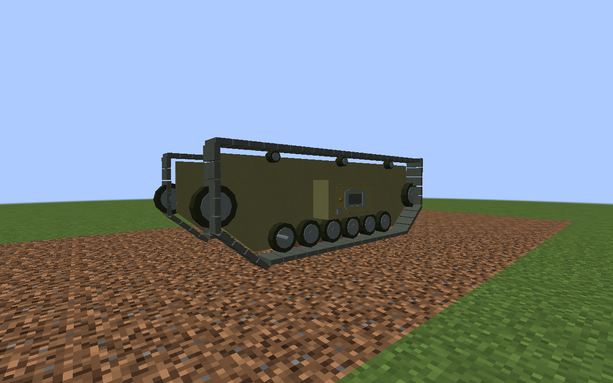
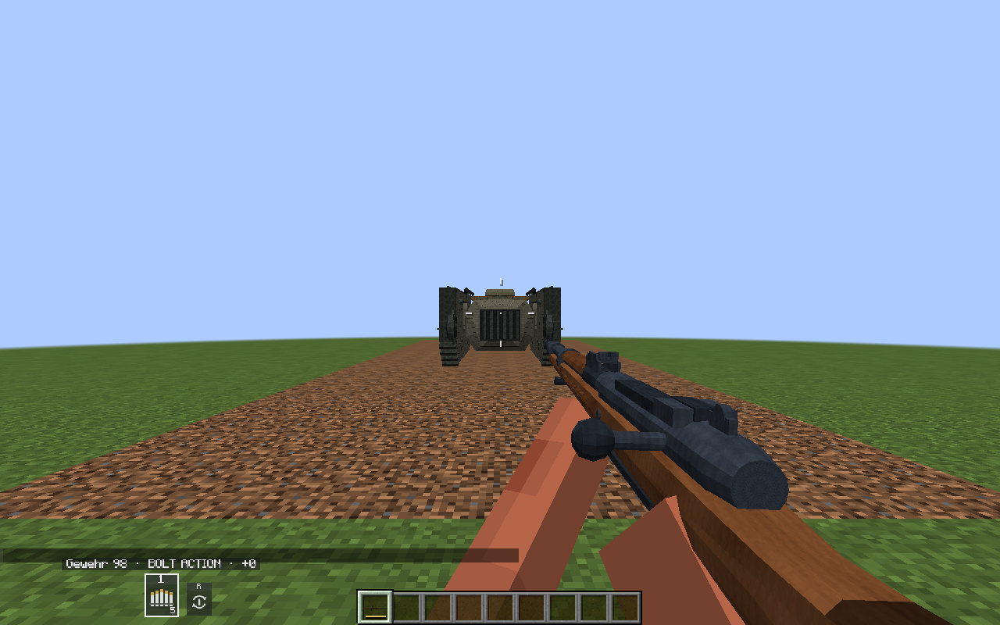
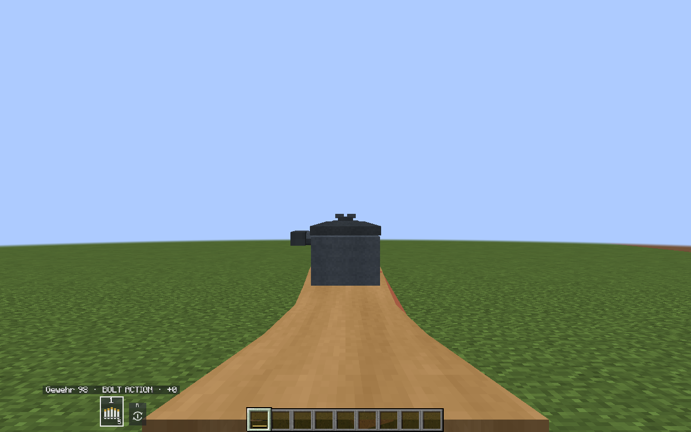
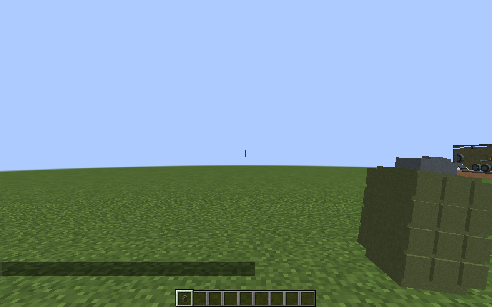
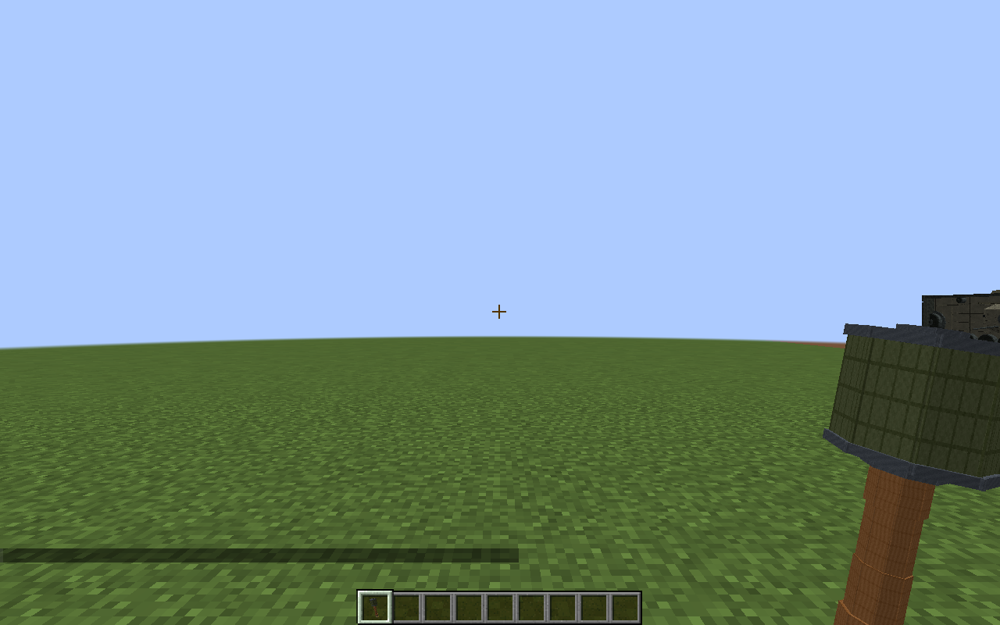
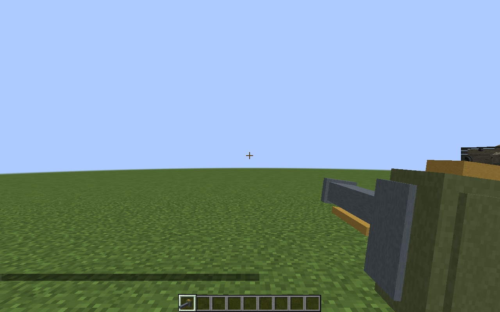
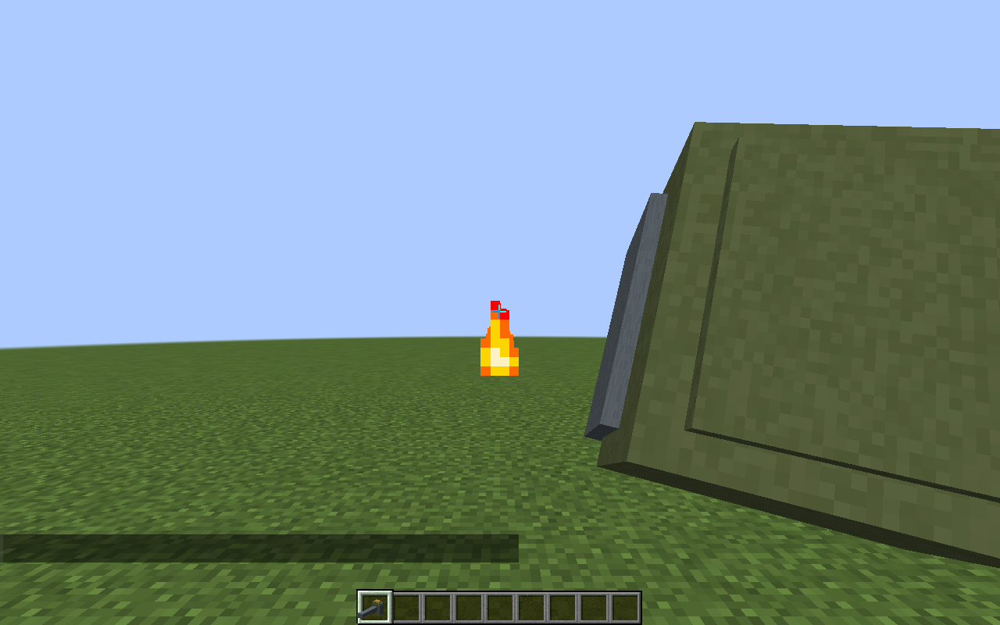

# AI Arsenal

Военная техника, стрелковое оружие и снаряжение разных исторических эпох для **Minecraft 1.20.1**.

**Forge 47.4.23 · Java 17 · Альфа-версия**

## Первая мировая

- **Mark I Male** — британский гусеничный танк с двумя 57-мм орудиями в бортовых спонсонах. Места водителя и наводчика, фугасные и бронебойные выстрелы, повреждения и перезарядка.
- **Gewehr 98** — пятизарядная винтовка с ручным затвором, заряжанием обоймой и прицеливанием через модель.
- **Граната Миллса** и **ручная граната обр. 1915 года** — метательные гранаты с отсчётом после броска.
- **Огнемёт Wex** — короткая струя пламени с расходуемым топливом. Стены и жидкости перекрывают огонь; под водой огнемёт не работает. Блоки не поджигает.

Характеристики и управление адаптированы для Minecraft. В мод также входят техника, авиация, артиллерия и оружие других эпох.

## Скачать и установить

**[Скачать AI Arsenal 1.0.1-alpha.16 — JAR](https://github.com/standimaoff-oss/aiarsenal/releases/download/v1.0.1-alpha.16/aiarsenal-1.0.1-alpha.16.jar)** · [Страница версии и контрольная сумма](https://github.com/standimaoff-oss/aiarsenal/releases/tag/v1.0.1-alpha.16)

1. Установите Minecraft 1.20.1 и Forge 47.4.23.
2. Поместите один JAR мода в папку `mods` клиента и сервера.
3. Удалите предыдущий JAR AI Arsenal, если он установлен.

Перед установкой альфа-версии сделайте резервную копию мира.

## Управление

| Предмет | Управление |
|---|---|
| Gewehr 98 | ЛКМ — выстрел, ПКМ — прицел, R — перезарядка пустого магазина |
| Гранаты | ПКМ — бросок |
| Wex | Удерживать ПКМ — огонь, Shift+ПКМ — заправить предметом топлива из инвентаря |

[Полное управление](docs/controls.md) · [Снаряжение Первой мировой](docs/wwi-equipment.md)

## Предпросмотр

Настоящие игровые кадры из Minecraft, без внешнего рендера.

### Mark I


### Gewehr 98



### Снаряжение





[Все кадры и результат проверки](previews/).

## Сборка из исходников

```sh
python3 tools/restore_models.py
cd mods/aiarsenal
./gradlew build --no-daemon
```

На Windows: `python tools/restore_models.py`, затем `gradlew.bat build --no-daemon` в `mods/aiarsenal`.
Готовый JAR: `mods/aiarsenal/build/libs/`. Для первой сборки нужен доступ к серверам Gradle, Forge и Minecraft.

[Сторонние компоненты и лицензии](THIRD_PARTY_NOTICES.md).
